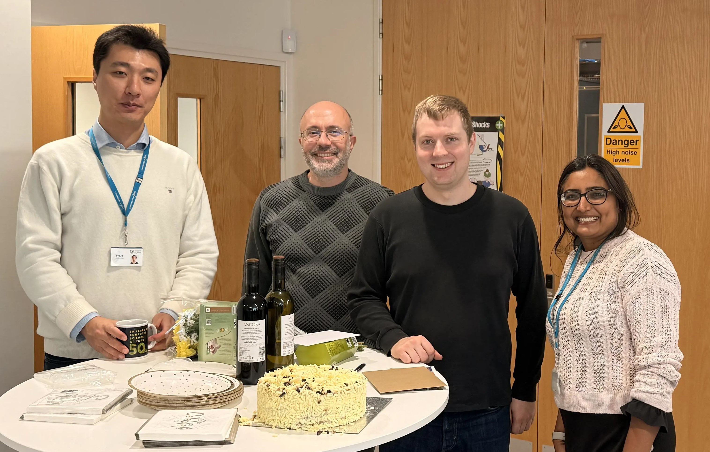

<!-- PUT PAGE CONTENT HERE (IN HTML OR MARKDOWN) -->

Congratulations to Joshua Levett on passing his Viva with minor corrections.

Josh completed his work on Measuring Internet Resilience Through Enhanced Inter-AS Topology Capture.

We from the Systron Lab wanted to congratulate his hard work over the past few years, and wish him the very best for his further research as a Cyber Security Researcher. 
