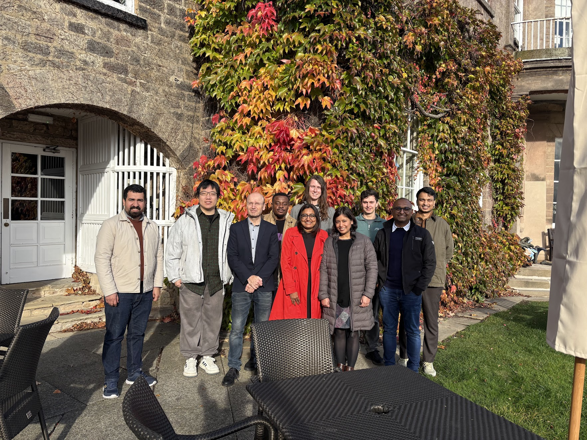
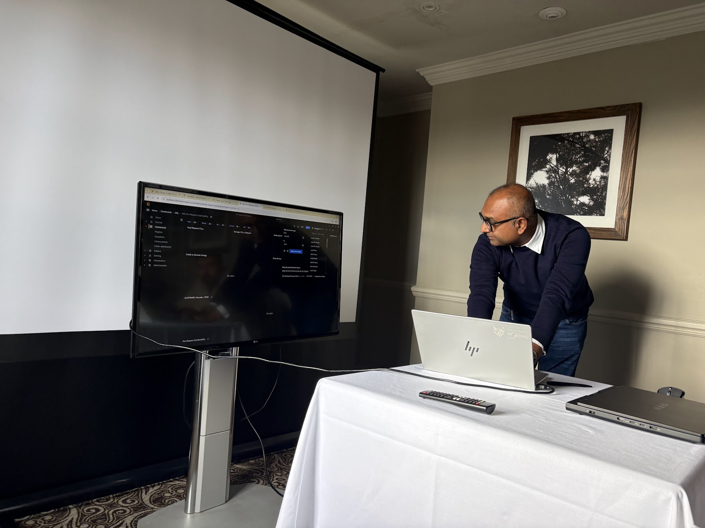
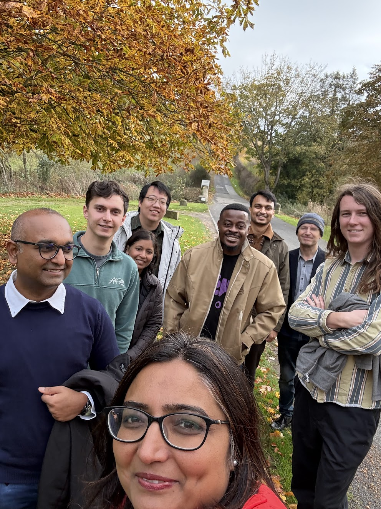
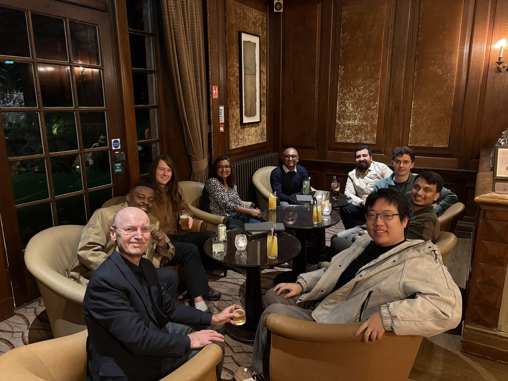

<!-- PUT PAGE CONTENT HERE (IN HTML OR MARKDOWN) -->

Members of the SYSTRON Lab took part in a Research Away Day at Wetherby Hotel & Spa. 

Here, researchers were able to collaborate and contribute to working ideas on the future direction of the lab. 

Members took turns presenting their ideas to the audience. This was followed by a Q&A styled feedback process, where audience members could provide the speaker with expertise from their own research areas.

The overall goal of this process was to encouraged collaboration between members and to evaulate the group's research focus for the coming months.

Overall, the event was a success, as all members stated they benefited greatly from be able to attend the event.

The success of the event has lead to the initial stages of repeating the Reserach Away Day in the coming months, this time with the aim to invite our industry collaborators to come along too. 

The Reserach Away Day also allowed members to relax at the fabulous grounds located at Wetherby Hotel & Spa. Recreational activities that reserachers took part in included a walk around the hotel's grounds, as well as utilising the Spa and Swimming Pool facilities.  

